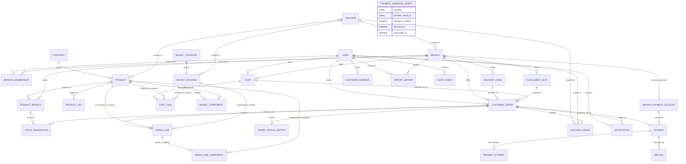
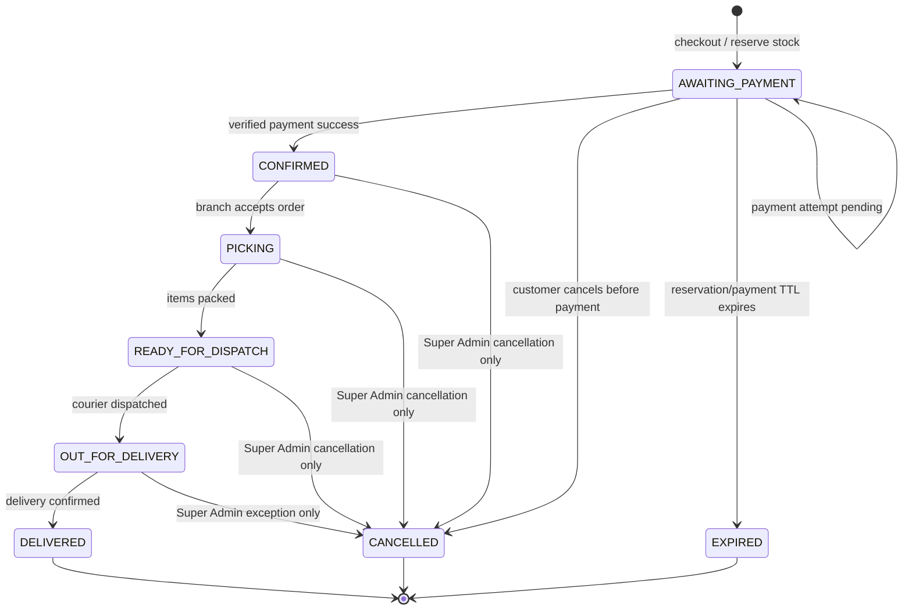

# FarmersHaus architecture

**Status:** Phase 1 architecture and Phase 2 backend foundation are implemented; Phase 3 order, checkout, payment, voucher, basket, notification, and staff-stream APIs are implemented.  
**Scope:** Hubtel's provider adapter is gated from live use pending verification of its current request, callback-signature, refund, and branch-settlement specifications. Provider matching for daily settlement reconciliation remains an onboarding item.

## 1. Repository layout

```text
farmershaus/
├── backend/
│   ├── apps/
│   │   ├── accounts/          # User identity, roles, branch memberships
│   │   ├── branches/           # Branches, delivery zones, branch payment accounts
│   │   ├── catalogue/          # Categories and sellable products
│   │   ├── inventory/          # Per-branch stock and reservations
│   │   ├── baskets/            # Food basket packages and component products
│   │   ├── cart/               # Branch-scoped shopping carts
│   │   ├── orders/             # Order snapshots and fulfilment lifecycle
│   │   ├── payments/           # Payment attempts, events, refunds, provider adapters
│   │   ├── vouchers/           # Voucher rules and per-customer usage
│   │   ├── content/            # Contact settings, pages, banners, FAQs
│   │   ├── notifications/      # In-app and outbound notification records
│   │   ├── reports/            # Scoped export jobs and report artifacts
│   │   └── audit/              # Append-only business/admin audit events
│   ├── config/
│   │   ├── settings/           # base.py, dev.py, prod.py
│   │   ├── asgi.py
│   │   ├── urls.py
│   │   └── wsgi.py
│   ├── .env.example
│   ├── manage.py
│   ├── pyproject.toml
│   └── README.md
├── frontend/
│   ├── public/brand/           # FarmersHaus logo; licensed font files when supplied
│   ├── src/
│   │   ├── app/                # Router, query client, providers
│   │   ├── components/         # Shared UI
│   │   ├── features/           # accounts, branches, catalogue, baskets, cart, checkout, orders, payments, vouchers, notifications
│   │   ├── hooks/
│   │   ├── lib/                # API client and shared utilities
│   │   ├── pages/
│   │   ├── stores/             # Zustand stores
│   │   ├── types/
│   │   └── main.tsx
│   ├── .env.example
│   ├── package.json
│   └── README.md
├── scripts/
│   └── backend.mjs            # Windows-friendly root scripts for Django commands
├── package.json               # Root npm workspace and terminal commands
└── docs/
    └── architecture.md
```

Branch records, not frontend constants, are the source of truth for branch names, addresses, payment configuration, stock, price overrides, and delivery coverage. The initial data set is:

1. FarmersHaus Dome — Aggrey Street, Dome, Accra
2. FarmersHaus Westland — 14 Ato Ahwoi Ave, Westland Junction, Accra
3. FarmersHaus North Legon — Wisconsin Road, Adjacent Antis, North Legon, Accra
4. FarmersHaus East Legon — ARS Roundabout, East Legon, Accra

Each branch's MoMo business line must be separately configured and verified with the payment provider; the public customer-service numbers are not assumed to be branch settlement accounts.

## 2. Implemented database models

Use PostgreSQL in production and SQLite for local development. Domain records use UUID primary keys (the singleton settings records use the fixed key `1`), UTC timestamps, and integer pesewa values for stored money (`GHS` is the currency code). Never use floating point for prices. Mutable records carry `created_at` and `updated_at`; singleton settings track `updated_at`, and append-only audit events track `occurred_at`.

The models and database constraints below are implemented in `backend/apps/*/models.py`. Cross-row rules that SQLite/PostgreSQL cannot express as check constraints are validated by model `clean()` methods and must also be enforced in transactional service code when APIs are added.

### Entity relationship diagram



### App models and constraints

| App | Proposed models and important fields / rules |
|---|---|
| **accounts** | `User` (custom `AbstractUser`, UUID, unique normalized phone, case-insensitive unique non-empty email, display name, active flag); `BranchMembership` (user, branch, role `STAFF`/`MANAGER`, active). Unique `(user, branch)`. `OTPChallenge` stores a hashed, expiring, single-use code and attempt count. Password login accepts phone/email/username; customer vs. staff roles come from memberships and Django superuser status. A user may be a customer and have branch memberships. Set `AUTH_USER_MODEL` before the first migration. |
| **branches** | `Branch` (UUID, unique slug, name, address, phone, paired latitude/longitude, weekday opening-hours JSON, placeholder-hours flag, active); `DeliveryZone` (branch, name, service-area description/postcodes, fee in pesewas, minimum order, active); `BranchPaymentAccount` (one-to-one branch, provider, provider merchant/account identifier, branch MoMo business line, supported networks, settlement mode, enabled, secret-manager reference). Never store provider secrets in this row; credentials remain in a deployment secret manager referenced by the account. |
| **catalogue** | `Category` (unique slug, name, display order, active); `ProductTag` (unique slug/name); `Product` (unique SKU, category, name, description, unit and unit type, `base_price_minor`, primary/gallery image URLs, nutrition JSON, origin, tags, active). Product identity, base price, and content are global; branch availability, stock, and optional price override are not fields on `Product`. |
| **inventory** | `ProductBranch` (branch, product, `stock_on_hand`, `reserved_quantity`, `is_available`, nullable `price_override_minor`, timestamps). Unique `(branch, product)`; `stock_on_hand >= 0`, `reserved_quantity >= 0`, `reserved_quantity <= stock_on_hand`; a product is sellable only when active and its branch row is available with sufficient unreserved stock. Effective price = override or product base price. `StockReservation` (order, order line, product-branch, quantity, expiry, status, released/consumed timestamps). Reservation totals must be changed inside a DB transaction while locking the affected `ProductBranch` rows; the aggregate cannot be safely enforced by a row-level check alone. |
| **baskets** | `BasketCategory` (unique slug, name, display order, active); `BasketPackage` (unique SKU/slug, optional category, name, description, image, base price in pesewas, `is_placeholder`, gift-message flag, active); `BasketComponent` (package, product, quantity, optional flag). Unique `(package, product)` and positive quantity. At checkout, copy required component names, units, and quantities into order-line component snapshots; later package edits must not rewrite an existing order. Basket stock is derived from required component products at the selected branch. |
| **cart** | `Cart` (optional user, branch, UUIDv4 guest session key, status, expiry); `CartItem` (cart, exactly one of product or basket package, quantity 1–999, optional gift recipient/message). A check constraint enforces exactly one sellable reference; quantity is bounded. Guest carts are branch-bound, and login merges guest items. Product and basket availability are revalidated before checkout. |
| **orders** | `CustomerAddress` (user, recipient, phone, address lines, area, directions, optional coordinates); `FulfillmentSlot` (branch, delivery/pickup method, start/end, positive capacity, active); `CustomerOrder` (unique public order number, user, branch, optional delivery zone/slot/cart, fulfillment method, status, payment-independent fulfilment amounts, configurable currency, immutable address/branch/delivery snapshots, voucher reference/code snapshot, lifecycle timestamps); `OrderLine` (order, exactly one of product or basket package, SKU/name/unit/optional-gift snapshots, quantity, unit and line total in pesewas); `OrderLineComponent` (order line, nullable product reference, name/unit/quantity snapshots); `OrderStatusHistory` (from/to status, optional actor, note). Checkout locks cart, inventory, and slot rows; reserves stock in the same transaction. |
| **payments** | `Payment` (one-to-one order, branch payment account, method/network, amount/currency, status, provider, unique merchant idempotency reference); `PaymentAttempt` (payment, unique local idempotency key, checkout/provider references, hosted checkout URL, redacted request/response metadata, status/result/timestamps); `PaymentWebhookEvent` (provider/event ID unique per provider, signature-verified flag, received/processed timestamps, minimal redacted payload/error); `Refund` (payment, unique idempotency key/provider reference, amount, status, reason, requested/approved by, last error). A payment is marked succeeded only after a verified webhook with matching reference, amount, and currency; browser redirects never confirm payment. |
| **vouchers** | `Voucher` (case-insensitive unique code, active window, percent or fixed pesewa discount, minimum spend, maximum discount, total/per-customer limits, optional single-branch and many-to-many branch/product/basket scopes, active); `VoucherUsage` (voucher, user, order, amount saved, reserved/redeemed/released state). Unique `(voucher, order)`; limits are locked and enforced transactionally at checkout. |
| **content** | One `SiteSettings` singleton for contact phones, WhatsApp numbers, email, social links, announcement/delivery-policy copy, configurable currency, and tagline; `ContentPage` (unique slug, title, published body); `Banner` (asset, link, schedule, active); `FAQ` (question, answer, order, active). A data migration consolidates the legacy contact singleton into this one record. |
| **notifications** | `Notification` (user, optional order, channel, template/key, status, redacted metadata, sent/read timestamps); `DeliveryAttempt` (notification, provider reference, status, retry count, next retry, last error). Celery retries must be idempotent and must not alter payment/order truth. |
| **reports** | `ReportExport` (requester, optional branch scope, report type, filters, format, status, private file reference, expiry, error summary). Branch-scoped staff may request only exports for assigned branches; reports aggregate source records and are not an alternate source of financial truth. |
| **audit** | `AuditEvent` (actor, optional branch, action, resource type/ID, request correlation ID, timestamp, redacted before/after JSON, source IP/user-agent as policy permits). Append-only to application roles; record stock adjustments, role/branch changes, voucher changes, payment configuration, refunds, and admin order cancellations. Do not copy secrets or full payment credentials into audit payloads. |

### Cross-cutting invariants

- Branch is fixed on cart, order, and payment; switching branches creates/revalidates a different cart and never silently migrates an order.
- Prices and address, branch, delivery, voucher, and basket component details are snapshotted at placement.
- Use `transaction.atomic()` and `select_for_update()` for stock, voucher limits, order checkout, and payment-state transitions.
- Payment status and order fulfilment status are separate state machines. Every transition is validated in a service layer and recorded in the audit trail.
- Enforce tenant scope in queryset/service layers, not only in the UI. A branch manager cannot grant themselves another branch.
- Soft-disable branches/products/accounts rather than deleting records referenced by orders.
- `full_clean()` validation is not automatically invoked by Django `save()`; API/service code must explicitly validate cross-row relationships and enforce stock/voucher aggregates transactionally.

## 3. REST API

Base path `/api/v1/`. JSON unless the endpoint returns a private report download. **Default permission is authenticated**; public reads and registration/token endpoints explicitly allow anonymous access. JWT is the customer/staff bearer token. Branch scope is derived from the authenticated user's active `BranchMembership`; a client-supplied branch ID is a filter, never proof of access.

Endpoints marked **implemented** are present in the backend. Rows without that marker remain the approved future API plan.

### Accounts

| Endpoint | Access |
|---|---|
| `POST /auth/token/`, `POST /auth/token/refresh/` **implemented** | Public; SimpleJWT credentials/refresh |
| `POST /auth/otp/request/`, `POST /auth/otp/verify/` **implemented** | Public, throttled; codes hashed, expiring, single-use, and delivered by configured SMS/email backends |
| `POST /auth/register/` **implemented** | Public; creates a customer account without accepting privilege fields |
| `GET/PATCH /me/` **implemented** | Authenticated customer/staff; self only |
| `GET/POST /addresses/`, `GET/PATCH/DELETE /addresses/{id}/` **implemented** | Authenticated customer; own addresses only |
| `GET /admin/users/`, `PATCH /admin/users/{id}/role/` | Super Admin only; never customer-controlled role escalation |
| `GET/POST/PATCH /admin/branch-memberships/` | Super Admin; managers may manage staff in their own branch only |

### Branches and delivery zones

| Endpoint | Access |
|---|---|
| `GET /branches/`, `GET /branches/{slug}/`, `GET /branches/nearest/?latitude=...&longitude=...` **implemented** | Public; active branches only; open status computed from branch-local hours |
| `GET /branches/{slug}/delivery-zones/` **implemented**; `POST /delivery-quote/` planned | Public; active zones only; delivery quote is future work |
| `GET /staff/branches/` **implemented** | Authenticated staff; assigned branches only; Super Admin sees all active branches |
| `POST/PATCH /admin/branches/`, `POST/PATCH /admin/delivery-zones/` | Super Admin; managers may edit delivery zones for their branch, not create global branches |
| `GET/PATCH /admin/branches/{id}/payment-account/` | Super Admin only; credentials are write-only secret references and never returned |

### Catalogue and inventory

| Endpoint | Access |
|---|---|
| `GET /categories/` **implemented** | Public; active categories |
| `GET /products/`, `GET /products/{slug}/`, `GET /search/suggestions/` **implemented** | Public; requires active `branch`; supports search, category/tag/season/organic filters, branch-effective price sorting, pagination, and available alternatives when unavailable at the selected branch |
| `GET /branches/{branch_id}/inventory/` **implemented** | Authenticated staff; assigned branch only |
| `POST /branches/{branch_id}/inventory/adjustments/` **implemented** | Branch Staff/Manager for assigned branch; nonzero delta, reason, and required `Idempotency-Key`; writes inventory adjustment and audit event |
| `GET/PATCH /branches/{branch_id}/inventory/{product_id}/` **implemented** | Branch Staff/Manager for assigned branch; updates branch availability/price; reason required and audited |
| `POST/PATCH /admin/products/`, `POST/PATCH /admin/categories/` | Super Admin; managers may maintain branch-local availability/price only |

### Food baskets

| Endpoint | Access |
|---|---|
| `GET /basket-categories/`, `GET /basket-packages/`, `GET /basket-packages/{slug}/` **implemented** | Public; packages require active `branch` query parameter; includes component data, placeholder/gift flags, and computed availability |
| `POST/PATCH /admin/basket-packages/`, `POST/PATCH /admin/basket-packages/{id}/components/` | Super Admin; branch managers may not change global package composition |

### Cart

| Endpoint | Access |
|---|---|
| `GET /cart/`, `POST /cart/items/`, `PATCH /cart/items/{id}/`, `DELETE /cart/items/{id}/` **implemented** | Customer or guest with `X-Cart-Session` UUIDv4; cart owner/session only; branch immutable |
| `POST /cart/validate/` **implemented** | Customer or guest session; checks product and required basket component stock/availability |

### Orders

| Endpoint | Access |
|---|---|
| `GET/POST /addresses/`, `PATCH/DELETE /addresses/{id}/` **implemented** | Authenticated customer; account API restricts addresses to owner |
| `GET /fulfillment-slots/?branch={id}&method=delivery|pickup` **implemented** | Authenticated customer; active future slots and remaining capacity |
| `POST /checkout/` **implemented** | Authenticated customer; own open cart, branch/address/zone/slot validation, atomic stock reservation and order snapshots |
| `GET /orders/`, `GET /orders/{order_number}/`, `/tracking/` **implemented** | Authenticated customer; own orders; assigned branch staff and Super Admin may access permitted orders |
| `POST /orders/{order_number}/cancel/` **implemented** | Customer only while awaiting payment; after payment only Super Admin can cancel and request refund |
| `GET /orders/{order_number}/receipt.pdf` **implemented** | Authenticated customer/assigned branch staff/Super Admin; only after payment confirmation |
| `GET /staff/orders/?branch={id}` **implemented** | Branch Staff/Manager assigned to that branch; Super Admin all branches |
| `PATCH /staff/orders/{order_number}/status/` **implemented** | Branch Staff/Manager assigned to that order branch; paid orders only and valid next lifecycle status |
| `GET /staff/orders/paid-stream/?branch={id}` **implemented** | Authenticated SSE; assigned branch staff/manager or Super Admin |

### Payments

| Endpoint | Access |
|---|---|
| `POST /payments/orders/{order_number}/initiate/`, `/retry/` **implemented** | Authenticated owner; branch Hubtel account must be enabled and settlement-verified; retries use a new idempotency key |
| `GET /payments/orders/{order_number}/status/` **implemented** | Authenticated customer, assigned branch staff/manager, or Super Admin; redacted status |
| `POST /payments/webhooks/hubtel/` **implemented, provider contract gated** | Public transport; raw-body HMAC verification, idempotency, reference/amount/currency checks |
| `POST /payments/refunds/{id}/retry/` **implemented** | Super Admin only; retries a stored refund request |
| `GET /payments/reconciliation/daily/?branch={id}&date=YYYY-MM-DD` **implemented** | Assigned branch staff/manager or Super Admin; internal totals and review-needed records, not provider statement matching |

### Vouchers, content, notifications, reports, and audit

| Endpoint | Access |
|---|---|
| `POST /vouchers/validate/` **implemented** | Customer/guest cart owner; validates code/quote only, checkout reserves usage |
| `POST /vouchers/bulk/` **implemented** | Super Admin only; creates 1–500 generated codes per request |
| Django admin vouchers **implemented** | Super Admin creates/edits individual codes, limits, and branch/product/basket scopes |
| `GET /site-settings/` **implemented** | Public; returns the single editable site/contact settings record |
| `GET /content/pages/{slug}/`, `GET /content/banners/`, `GET /content/faqs/` | Public; published/active records |
| `PATCH /admin/content/contact/`, `/admin/content/pages/`, `/admin/content/banners/`, `/admin/content/faqs/` | Super Admin only |
| `GET /notifications/`, `POST /notifications/{id}/read/` **implemented** | Authenticated customer; own notifications only |
| `GET /notifications/stream/` | Authenticated Customer or staff; future notification SSE stream |
| `GET /staff/notifications/` | Branch Staff/Manager; assigned branch notifications |
| `POST /admin/reports/exports/`, `GET /admin/reports/exports/{id}/` | Super Admin; managers may request assigned-branch exports only |
| `GET /admin/reports/exports/{id}/download/` | Export owner or Super Admin; branch manager only for own-branch exports; short-lived private download |
| `GET /admin/audit-events/` | Super Admin; branch manager may view only permitted branch events |

OpenAPI schema and Swagger UI: `/api/schema/` and `/api/docs/`. Protect schema/docs in production if operational policy requires it.

## 4. Roles and branch authorization

The matrix below describes the implemented least-privilege baseline. Operational policy may further narrow branch-manager capabilities; branch IDs supplied by clients never grant access.

| Capability | Guest | Customer | Branch Staff | Branch Manager | Super Admin |
|---|---:|---:|---:|---:|---:|
| Browse active branches, catalogue, baskets, published content | Yes | Yes | Yes | Yes | Yes |
| Maintain a branch-bound cart | Signed guest token | Own cart | No customer cart privilege by role | No customer cart privilege by role | No customer cart privilege by role |
| Place/view/cancel own unpaid orders | No checkout | Own orders; cancel only before payment | No | No | All branches; admin cancellation audited |
| View/fulfil branch orders | No | Own orders only | Assigned branch | Assigned branch | All branches |
| Adjust inventory | No | No | Assigned branch; reason and audit required | Assigned branch; reason and audit required | All branches |
| Edit branch delivery zones | No | No | No | Assigned branch | All branches |
| Edit products or basket definitions | No | No | No | Branch availability/price only | Global catalogue and package components |
| Manage staff or memberships | No | No | No | Assigned branch staff only, if enabled | All branches and roles |
| Configure branch payment account | No | No | No | No | All branches; secrets never readable |
| Issue refund/post-payment cancellation | No | No | No | No | Yes; audited and idempotent |
| View reports/audit | No | No | Assigned branch operational reports | Assigned branch reports and allowed audit | Global |

**Enforcement:** Branch-scoped APIs resolve allowed branch IDs from memberships on the server and intersect those IDs with any requested filter. A foreign branch ID returns `404` or `403` consistently without leaking records. Super Admin status is explicit (`is_superuser`/staff policy), never inferred from a branch manager flag. All sensitive writes carry actor, branch, reason, and audit correlation data.

## 5. Payment-provider design

### Options for one branch payment destination per branch

| Option | Benefits | Trade-offs / checks |
|---|---|---|
| **Paystack subaccounts / split payments** | One platform integration; split payment and subaccount concepts can support routing shares to separate subaccounts; Paystack documents Ghana mobile-money payments. | Subaccount settlement destinations and eligible methods depend on country/account configuration. Do not assume Ghana mobile-money collections can settle directly to each branch's MoMo business wallet. Obtain written confirmation of Ghana account eligibility, settlement destination, fees, refunds, and whether each branch must be a separately verified Paystack business. |
| **Hubtel merchant integration** | Ghana-focused; its developer portal advertises mobile-money acceptance across networks, card acceptance, and bank transfers. Potentially better local support and network coverage for the requested MoMo experience. | Confirm exact checkout/collection API, per-branch merchant-account onboarding, settlement to each branch's intended MoMo business line, webhook guarantees, reversals, reconciliation, and fees with Hubtel. Public marketing does not itself guarantee per-branch wallet settlement. A separate merchant account per branch may require provider approval. |
| **Direct MTN MoMo Collections API** | First-party MTN collection flow and direct operational relationship; each branch can be mapped to its own eligible merchant configuration if MTN approves it. | MTN-only: it does not collect from Telecel or AT Ghana wallets. Every branch needs MTN merchant onboarding, collection product/API credentials, callbacks and reconciliation; confirm settlement to the exact branch business line. Multiple network integrations and operations would be required. |

### Recommendation (conditional on settlement onboarding)

**Start provider due diligence with Hubtel**, asking for one separately identifiable merchant account/settlement destination per branch and confirmation that each branch's MoMo business line is a supported settlement destination. It is the strongest fit to broad Ghana network coverage without assuming subaccount settlement semantics.

Do **not** go live until a sandbox and low-value production pilot demonstrate: branch-to-account routing, all intended networks, verified asynchronous success/failure, reversal/refund behavior, settlement reconciliation, and correct branch statements. If Hubtel cannot contractually map settlements to the required branch destinations, use Paystack only after written confirmation that its Ghana account/subaccount settlement supports those exact destinations; if only MTN needs to launch, direct MTN Collections is a viable narrower fallback. Provider capabilities, fees, and onboarding can change; verify against the branch-specific merchant agreements before implementation.

Each branch should provide the provider's approved business KYC and settlement details, a unique provider merchant/account identifier and MoMo business line, settlement/reconciliation contact, supported networks, and the signed authorization needed to accept payments. Credentials belong in the deployment secret manager, not in source control or ordinary branch API responses. The platform should separately record provider/account IDs and the secret reference on each branch's `BranchPaymentAccount`.

### `PaymentProvider` boundary and safety flow

The `PaymentProvider` boundary in `apps/payments/providers.py` isolates checkout initiation, raw-body webhook verification, and refund submission. The current Hubtel adapter maps provider responses into checkout URLs and internal references; the endpoints, request/response field names, HMAC header/format, and refund payload are **provisional** until confirmed against current Hubtel merchant documentation. Live initiation is disabled by default and additionally requires `BranchPaymentAccount.is_enabled`, `settlement_verified`, a secret-manager-backed credential object, and the explicit `HUBTEL_LIVE_ENABLED` deployment flag. There is no claim of provider-status lookup or statement matching until Hubtel supplies those interfaces.

1. Checkout locks and validates branch inventory and voucher limits, creates the unpaid order and expiring stock reservations in one DB transaction, then commits.
2. Payment-intent creation uses a stable local idempotency key and unique provider reference. A retry returns the existing attempt instead of charging twice. Provider network calls happen outside a long-held inventory transaction.
3. Keep reservations for a configured TTL (`ORDER_RESERVATION_MINUTES`, default 15). Celery Beat sweeps due unpaid orders every minute; the task atomically expires them, releases reserved quantities and voucher use exactly once, and appends status history.
4. If payment success races reservation expiry, serialize order/payment/reservation transitions with row locks. A verified success before release consumes the reservation; a late success after release must be reconciled into a paid exception for staff/admin to resolve (never silently confirm unavailable stock or automatically claim a refund).
5. Webhook handler reads exact raw request bytes, verifies provider signature/authentication before parsing, checks event ID/idempotency and expected account/order/amount/currency, records the event, and applies the transition atomically. Reject invalid signatures; duplicate verified events return an acknowledgement. Provider status queries and external settlement reconciliation remain pending provider documentation.
6. Never mark an order paid based only on the browser return URL. Redact secrets and sensitive payer data from logs. Admin refunds use their own idempotency key and audit entry.

## 6. Order status state machine

Payment and fulfilment are distinct: `Payment.status` is `CREATED / PENDING / SUCCEEDED / FAILED / EXPIRED / REFUND_PENDING / PARTIALLY_REFUNDED / REFUNDED`; order status captures fulfilment and cancellation. The customer cancellation endpoint only permits an unpaid order.



Post-payment customer cancellation is unavailable online. An admin cancellation does not erase the payment: any refund is a separate `Refund` record, and the order/payment/audit histories remain intact. Define allowed transitions centrally; reject all unlisted transitions.

Lifecycle timestamps are recorded for payment confirmation, picking, dispatch readiness, out-for-delivery, delivery, cancellation, and expiration. The reservation TTL is configurable and should be tuned after confirming provider authorization latency and the customer payment experience.

## 7. Project initialization and local setup

### Backend

The backend uses split settings (`dev` default, explicit `prod`), `.env` loading, CORS middleware, DRF, SimpleJWT, and drf-spectacular. Domain apps and the custom `AUTH_USER_MODEL` are installed before their initial migrations. The root npm scripts create a Python virtual environment, install dependencies, and invoke Django commands without requiring shell activation.

```powershell
npm.cmd run setup
npm.cmd run backend:check
npm.cmd run backend:migrate
npm.cmd run backend:dev
```

From the repository root, the `npm.cmd run backend:*` scripts invoke Django through `backend/.venv` and work in PowerShell without activating the environment.

For production, set `DJANGO_SETTINGS_MODULE=config.settings.prod`, configure PostgreSQL and trusted CORS/CSRF origins, use a managed secret store, and run migrations as a release step. Never use SQLite, debug mode, wildcard CORS, or the development secret in production.

### Frontend

```powershell
npm.cmd run frontend:dev
npm.cmd run frontend:build
npm.cmd run frontend:lint
```

The starter router has only placeholder home/not-found routes. The supplied FarmersHaus logo is at `public/brand/farmershaus-logo.png`; Tailwind tokens use the FCH sister-company primary colors. Licensed font files should be placed in `public/brand/fonts/` when available; the CSS stacks already name the brand fonts with system fallbacks.

### Environment variables

Backend: `DJANGO_SETTINGS_MODULE`, `DJANGO_SECRET_KEY`, `DJANGO_ALLOWED_HOSTS`, `CORS_ALLOWED_ORIGINS`, `CSRF_TRUSTED_ORIGINS`, and PostgreSQL connection settings. Frontend: `VITE_API_BASE_URL`. Provider credentials are intentionally absent from `.env.example`; use the deployment secret manager and branch account secret references.

## References for provider due diligence

- Hubtel developer portal: <https://developers.hubtel.com/> (describes Ghana mobile-money collections across networks, cards, and transfers).
- Paystack split payments: <https://paystack.com/docs/payments/split-payments/> and mobile money: <https://paystack.com/docs/payments/mobile-money/>.
- MTN MoMo developer documentation: <https://momodeveloper.mtn.com/api-documentation>.

The provider recommendation above is a design proposal, not a claim that any provider has approved FarmersHaus, a particular settlement destination, or a fee schedule.

### Realtime updates

The authenticated branch paid-order SSE endpoint is implemented at `/api/v1/staff/orders/paid-stream/?branch={id}` and emits when verified payment creates a `CONFIRMED` order-history entry. It uses bounded database polling and reconnect/refetch semantics; use fetch-based streaming for JWT bearer headers and never put access tokens in query strings. Customer order status updates are available from the tracking endpoint; a customer notification SSE stream and Redis pub/sub optimization remain future improvements. Adopt Channels/WebSockets only if a future requirement needs bidirectional live sessions.
